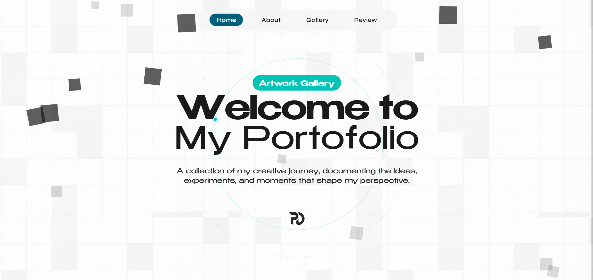
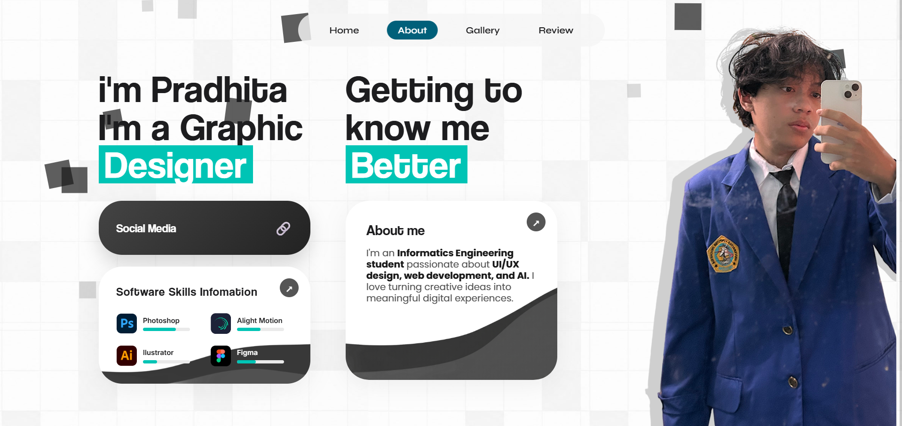
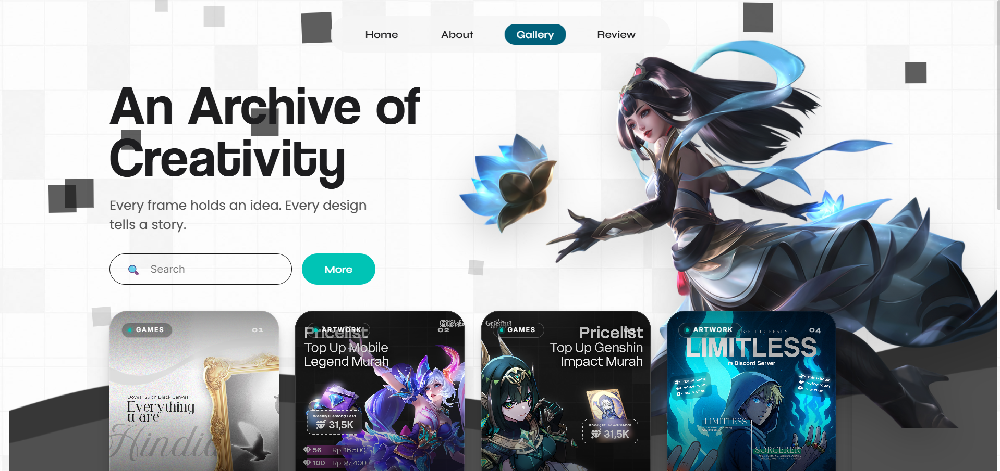
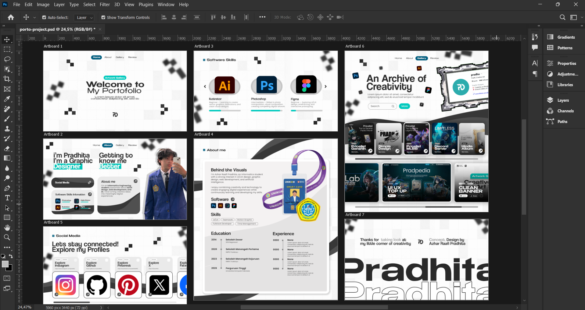

# NEXTGEN — Creative Portfolio

<em>A Work in Progress — Personal Portfolio Website</em>

NEXTGEN is an ongoing personal web portfolio project built to showcase my creative work, visual explorations, and front-end development journey.

This project combines manually crafted visual design with AI-assisted coding to bring my creative vision into a functional and interactive website.

## Project Philosophy

**100% Manually Designed. AI-Assisted Development.**

Every visual concept, layout, composition, color choice, typography, and design element is personally created and arranged manually. The entire design direction comes from my own creative process, without relying on AI-generated designs.

For the coding and implementation process, I use AI tools as development assistants to help write, refine, debug, and optimize the code while maintaining my original design vision.

AI is a coding assistant, not the creator of the design.

## Preview







## Original Design Showcase

The original visual concepts and artwork are manually created using Adobe Photoshop before being implemented into the website.



## Tech Stack

- HTML5
- CSS3
- JavaScript
- Adobe Photoshop
- AI-assisted coding tools

## Project Structure

```text
Nextgen-Porto-Web/
├── assets/
│   └── fonts/
├── design-showcase/
├── screenshots/
├── index.html
└── README.md
```

## Development Status

**Currently in Development**

This portfolio is an evolving project. Features, animations, responsiveness, interactions, and visual details are continuously being refined and improved.

## Credits

Designed and creatively directed by me, with AI assistance throughout the coding and development process.

---

*Built with personal creativity, attention to detail, and a little help from AI.*